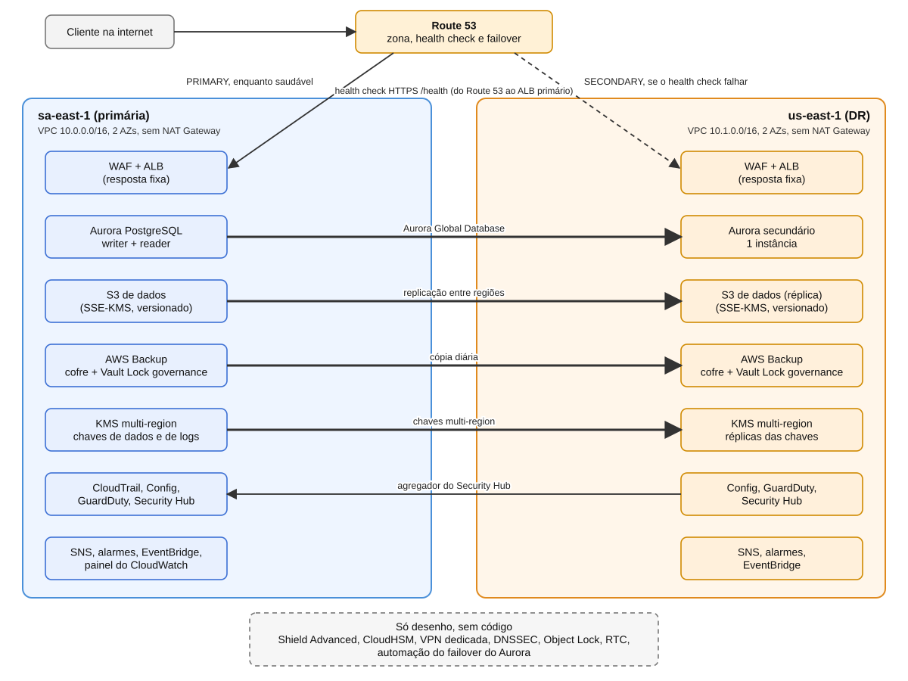

# Banco Rio: infraestrutura AWS em Terraform

Case 3 do meu portfólio de arquitetura AWS: um banco **fictício** com alta disponibilidade, proteção de dados sensíveis, auditoria de acessos e recuperação de desastre (DR) entre duas regiões, escrito em Terraform com módulos.

> **Projeto de estudo.** O código é validado com `terraform fmt`, `validate` e `plan` (166 recursos no `plan` final). Nunca foi aplicado (`apply`), então não há ambiente rodando e nenhum número de disponibilidade, RPO, RTO ou custo foi medido. Os valores de RPO e RTO da documentação são **metas de projeto**, e o custo é um cálculo sobre preços de lista.
>
> O projeto é **alinhado a boas práticas** de segurança e resiliência. Não afirma conformidade com BACEN, LGPD, PCI-DSS ou SOX.



## Escopo

Resiliência e recuperação de desastre, numa conta só:

- Regiões **sa-east-1** (São Paulo, primária) e **us-east-1** (N. Virginia, DR)
- Aurora PostgreSQL Global Database
- Route 53 com failover por health check
- S3 com replicação entre regiões
- KMS multi-region, WAF, CloudTrail, GuardDuty, Security Hub e AWS Config
- AWS Backup com cópia para o DR e Vault Lock em modo governance
- Monitoramento com alarmes, regras do EventBridge e painel do CloudWatch

Só no desenho e na análise de custo: Shield Advanced, CloudHSM e VPN dedicada (D-08).

## O que este case mostra

- Duas regiões com os mesmos módulos, chamados duas vezes com providers diferentes.
- Chaves KMS multi-region que deixam o Aurora e o S3 replicarem dados criptografados.
- Failover de DNS por health check e o que ele **não** faz (promover o Aurora é um passo separado).
- Auditoria de acessos (CloudTrail, Config) e detecção (GuardDuty, Security Hub).
- Backup com cópia entre regiões e retenção travada, e por que replicação não é backup.
- Honestidade sobre limites: cada decisão diz o que o `plan` não prova.

## Status

| Fase | Entrega | Situação |
| --- | --- | --- |
| 0 | Escopo e plano | Concluída |
| 1 | Base do repositório e providers das duas regiões | Concluída |
| 2 | Rede nas duas regiões | Concluída |
| 3 | KMS multi-region e VPC Flow Logs | Concluída |
| 4 | Aurora Global Database | Concluída |
| 5 | S3 com replicação entre regiões | Concluída |
| 6 | Borda: ALB, ACM e WAF | Concluída |
| 7 | DNS com failover | Concluída |
| 8 | Segurança e auditoria | Concluída |
| 9 | Backup e monitoramento | Concluída |
| 10 | Documentação final | Concluída |

## Estrutura

```
terraform/
  main.tf, variables.tf, providers.tf, versions.tf, outputs.tf
  modules/
    network/           VPC, subnets, rotas e security groups
    kms/               chaves de dados e de logs, multi-region
    vpc_flow_logs/     registro do tráfego das VPCs
    aurora_global/     Aurora PostgreSQL Global Database e segredo
    s3_replicated/     buckets com replicação entre regiões
    edge/              ACM, ALB e WAF
    dns/               zona, health check e failover
    audit_trail/       CloudTrail e bucket de auditoria
    config_recorder/   AWS Config
    threat_detection/  GuardDuty e Security Hub
    backup/            cofres, Vault Lock e plano do AWS Backup
    monitoring/        SNS, alarmes e regras do EventBridge
    dashboard/         painel do CloudWatch
docs/                  documentação e um caderno por fase
```

## Como validar

```bash
cd terraform
terraform fmt -check -recursive
terraform init
terraform validate
terraform plan
```

Este projeto **não usa `terraform apply`**. Para o `plan` funcionar, é preciso ter credenciais AWS com permissão de leitura nas duas regiões (as consultas de zonas de disponibilidade e de classes de instância do Aurora são feitas na AWS). O CI do repositório roda `fmt`, `validate`, `tflint` e `checkov` sem credenciais, sem `plan` e sem `apply`.

## Documentação

- [docs/ARCHITECTURE.md](docs/ARCHITECTURE.md): visão geral, fluxos de tráfego e de dados, failover, metas de projeto e limites
- [docs/DECISIONS.md](docs/DECISIONS.md): decisões, o que foi usado, o que não foi e por quê (D-01 a D-19)
- [docs/COST-ANALYSIS.md](docs/COST-ANALYSIS.md): custo de manter ligado, com fonte e data dos preços, e a análise de Shield Advanced, CloudHSM e VPN dedicada
- `docs/fase-XX-caderno.md`: caderno de cada fase, com conceitos, serviços não usados e perguntas de revisão

## Limites assumidos

- Nada foi aplicado: não há prova de que a replicação, os backups, os alarmes ou o certificado funcionam. Cada decisão lista o que só um `apply` confirmaria.
- A senha do banco é gerada pelo Terraform e fica no state local, que não vai para o Git (D-14).
- O domínio `banco-rio.example.com` é fictício e nunca foi validado.
- O bucket de auditoria e o bucket de dados não estão no AWS Backup nem replicados da mesma forma (D-18 e D-19).
- Tudo roda numa conta só; um banco real usaria várias contas (D-01).

## Reuso

Alguns módulos partem do case anterior [seguros-horizonte-aws](https://github.com/Flavio-Paixao/seguros-horizonte-aws), adaptados para duas regiões (D-06).
