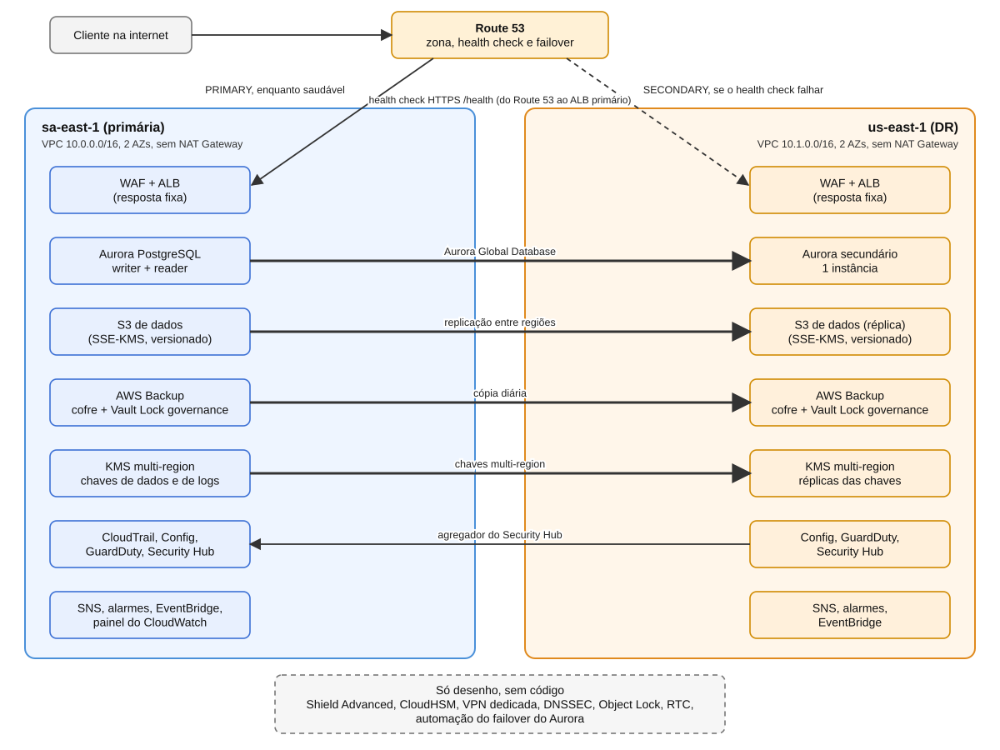

# Arquitetura

Banco **fictício** em duas regiões AWS, numa conta só: **sa-east-1** (São Paulo, primária) e **us-east-1** (N. Virginia, recuperação de desastre). O código é validado com `terraform fmt`, `validate` e `plan` (166 recursos no `plan` final) e **nunca foi aplicado**. Não há ambiente rodando, então nada aqui foi medido. Onde aparecem RPO e RTO, são **metas de projeto**.

O projeto é **alinhado a boas práticas** de segurança e resiliência. Não afirma conformidade com BACEN, LGPD, PCI-DSS ou SOX.

## Diagrama

Setas grossas são replicação ou cópia entre regiões. A seta tracejada é o caminho do failover de DNS. A caixa pontilhada lista o que é **só desenho**, sem código.

O arquivo [diagrama-arquitetura.svg](diagrama-arquitetura.svg) é um SVG escrito à mão, que pode ser editado em qualquer editor de texto.

## Como o tráfego chega

1. O cliente resolve o nome no Route 53. Enquanto o health check HTTPS (`/health`, a cada 30 segundos, 3 falhas seguidas) da região primária está saudável, o registro **PRIMARY** responde com o ALB de sa-east-1.
2. O pedido passa pelo **WAF** (quatro grupos de regras gerenciadas e um limite de requisições por IP) e chega ao **ALB**, que responde com uma resposta fixa. Não há camada de aplicação (D-04).
3. Se o health check falhar, o Route 53 passa a responder com o registro **SECONDARY**, o ALB de us-east-1, que tem o mesmo WAF.

Cálculo, não medição: 3 falhas a 30 segundos significam cerca de 90 segundos até o Route 53 declarar a primária fora do ar, mais o cache de DNS dos clientes.

## Como os dados são protegidos e replicados

| Dado | Mecanismo | Chave |
| --- | --- | --- |
| Banco | Aurora Global Database: cluster primário em sa-east-1 (writer e reader em 2 AZs), secundário em us-east-1 | Chave de dados multi-region (primária e réplica) |
| Objetos | Bucket em sa-east-1 com replicação para o bucket de us-east-1, com versionamento e HTTPS obrigatório | Chave de dados multi-region |
| Backups | AWS Backup: plano diário do Aurora, retenção de 35 dias, cópia para o cofre do DR, Vault Lock em modo governance | Chave de dados multi-region |
| Logs | CloudTrail, Config, Flow Logs, WAF e SNS, criptografados | Chave de logs multi-region |
| Segredo do banco | Secrets Manager, replicado para us-east-1 | Chave de dados multi-region |

Cada rede tem duas subnets públicas (só ALB) e duas privadas (banco), sem NAT Gateway, com security groups mínimos.

## Auditoria e detecção

- **CloudTrail** multi-região com eventos de gerenciamento e de dados dos buckets, validação de integridade, bucket de auditoria e log group.
- **AWS Config** com gravador e quatro regras gerenciadas em cada região.
- **GuardDuty** (proteção de S3 e de login no RDS) e **Security Hub** (padrão AWS Foundational Security Best Practices) nas duas regiões, com agregação do DR na primária.
- **EventBridge** manda achados do GuardDuty de severidade 7 ou mais e jobs de backup com falha para o SNS de cada região.

## Failover regional (como seria numa queda)

1. O Route 53 detecta a falha e passa a responder com o ALB do DR (automático, código desta fase 7).
2. **Promover o cluster Aurora secundário** é um passo separado. No Aurora Global Database, *failover* é a recuperação após queda da região e pode perder as últimas transações ainda não replicadas; *switchover* é a troca planejada, sem perda. Esse passo **não foi automatizado** (D-17).
3. A aplicação (que não existe neste case) teria de apontar para o endpoint do novo writer.

## Metas de projeto (não são medições)

| Meta | Valor | Base |
| --- | --- | --- |
| RPO do banco | Segundos | Latência de replicação que a AWS descreve como tipicamente abaixo de um segundo |
| RTO do DNS | Minutos | Cerca de 90 segundos de health check mais cache de DNS |
| RTO do banco | Minutos | Promoção do cluster secundário, passo manual |
| RPO dos objetos | Minutos, sem garantia | Replicação sem Replication Time Control |
| RPO dos backups | Até 24 horas | Plano diário |

Nenhum desses valores foi medido, e nenhum teste de restauração foi feito.

## Limites do que foi validado

O `plan` prova que o Terraform entende a configuração e quantos recursos criaria. Ele **não prova**:

- que o certificado ACM, de domínio fictício, seria emitido;
- que a replicação do S3, a entrega de logs do WAF, a entrega do Config no bucket com KMS e as condições das key policies funcionam;
- que os backups rodam, que a cópia chega ao DR ou que uma restauração funciona;
- que os alarmes disparam ou que o SNS entrega (não há assinantes);
- disponibilidade, desempenho ou custo real.

Outros limites assumidos: a senha do banco fica no state local (D-14); o bucket de auditoria não é replicado (D-18); o bucket de dados não está no AWS Backup (D-19); numa organização real, tudo isso rodaria dentro de uma estrutura multi-conta (D-01).

## Só no desenho

| Item | Onde está o desenho |
| --- | --- |
| Backend S3 do state com lock | D-03 |
| Shield Advanced, CloudHSM, VPN dedicada e Direct Connect | D-08 e COST-ANALYSIS |
| DNSSEC e query logging do Route 53 | D-17 |
| Rotação automática do segredo, `pgaudit` | D-14 |
| S3 Object Lock e Replication Time Control | D-15 |
| Vault Lock em modo compliance | D-19 |
| Automação do failover do Aurora | D-17 |

## Backend remoto do state (só desenho)

Hoje o state é **local** e está no `.gitignore` (D-03). Num ambiente real, o desenho seria:

- um bucket S3 versionado, com bloqueio de acesso público, criptografia SSE-KMS e política que nega tráfego sem HTTPS;
- bloqueio de state (lock) para impedir dois `apply` ao mesmo tempo;
- acesso por IAM de mínimo privilégio, separando quem lê o plano de quem aplica;
- o bucket criado por um passo à parte (*bootstrap*), porque ele precisa existir antes do `terraform init`.

Isso também resolveria a senha do banco no state (D-14), pois o state ficaria num lugar criptografado e controlado.

## Onde está cada coisa no código

| Pasta em `terraform/modules` | Conteúdo | Fase |
| --- | --- | --- |
| `network` | VPC, subnets, rotas e security groups (duas instâncias) | 2 |
| `kms`, `vpc_flow_logs` | Chaves multi-region e Flow Logs | 3 |
| `aurora_global` | Global Database e segredo | 4 |
| `s3_replicated` | Buckets e replicação | 5 |
| `edge` | ACM, ALB e WAF (duas instâncias) | 6 |
| `dns` | Zona, health check e failover | 7 |
| `audit_trail`, `config_recorder`, `threat_detection` | CloudTrail, Config, GuardDuty e Security Hub | 8 |
| `backup`, `monitoring`, `dashboard` | Cofres, plano, alarmes, regras e painel | 9 |
